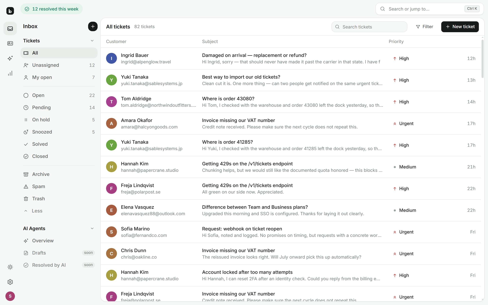

<p align="center">
  
</p>

<h1 align="center">BaseDesk</h1>

<p align="center">
  An open-source, self-hostable helpdesk with a fast, keyboard-first agent workspace.<br/>
  <em>One process. One SQLite file. No feature gates.</em>
</p>

---

## Why BaseDesk

We researched what people actually complain about in helpdesk software — Reddit, Hacker News, G2, review sites — and three themes came up over and over:

1. **Pricing punishes you for growing.** Per-seat taxes, SLAs and reporting locked behind $115+/agent tiers, metered AI resolutions, renewal ambushes.
2. **Incumbents are overbuilt.** Three-month deployments, dedicated admins, cluttered UIs; teams use less than a third of what they pay for.
3. **Open-source alternatives make you choose two of three:** modern UI, lightweight deploy, full feature set. Zammad needs Elasticsearch and 8 GB of RAM. FreeScout paywalls basics as "modules". osTicket looks like 2009. Chatwoot slows down at 15 agents.

BaseDesk is our answer:

- **Fast, beautiful, keyboard-first UI** — j/k through the inbox, `Ctrl/⌘ K` command palette, single-key actions, optimistic updates everywhere.
- **A generous core** — views, reporting, search, snooze, internal notes, canned replies: all product features, never pricing tiers. MIT-licensed, no telemetry, no open-core bait.
- **Runs anywhere** — a single Node process with a single SQLite file (Node's built-in `node:sqlite`, zero native dependencies). No Elasticsearch, no Redis.
- **AI as a copilot, not a gatekeeper** — designed for agent-side drafts, triage and summaries (BYO key, v0.2); never an unavoidable bot between you and your customers.

## Quickstart

### Docker (recommended)

```bash
git clone https://github.com/fizzexual/BaseDesk.git
cd BaseDesk
docker compose up -d
# → http://localhost:4011  (seeded with demo data on first boot)
```

### From source

Requires Node ≥ 23.4 (built-in SQLite).

```bash
npm install
npm run build
npm start
# → http://localhost:4011
```

Data lives in `./data/basedesk.db` (override with `DATA_DIR`); port via `PORT`.

## Development

```bash
npm install
npm run dev        # API on :4011, web on :4010 (proxied)
npm test           # server API tests + web store tests
npm run typecheck  # strict TS, both workspaces
```

- `web/` — Vite + React 19 + TypeScript strict + Tailwind v4. Custom design-token system, hand-drawn icon set, in-house SVG charts. One font (Inter Variable). No UI kit.
- `server/` — Hono + `node:sqlite`. REST API, seeds itself with realistic demo data on first boot.
- `shared/` — deterministic seed generator (`npm run seed`).

## The agent workspace

- **Inbox views**: All / Unassigned / My open / Snoozed / per-status / Archive / Spam / Trash, with live counts
- **Ticket workspace**: threaded conversation, internal notes with @mentions, canned replies, tags, snooze presets, customer-360 side panel
- **Command palette** (`Ctrl/⌘ K`): jump to any ticket, view, contact, or action
- **Keyboard-first**: `j/k` navigate · `e` solve · `u` assign to me · `1–4` priority · `s` snooze · `r` reply · `n` note · `?` all shortcuts
- **Reports**: created vs solved, priority mix, status distribution, per-agent load, first-reply/resolution medians
- **Light & dark themes**, WCAG-AA contrast

## API

The web app talks to a plain REST API you can use directly — see the route table in [`docs/superpowers/plans/2026-07-11-basedesk-v0.1.md`](docs/superpowers/plans/2026-07-11-basedesk-v0.1.md). Highlights: `GET /api/bootstrap`, `GET /api/tickets?view=…`, `POST /api/tickets/:id/messages`, `GET /api/stats`, `GET /api/search?q=…`.

## Roadmap

1. **v0.2 — Auth & teams** (first priority)
2. Email ingestion (IMAP/SMTP + Gmail/MS365 OAuth) — bulletproof threading or nothing
3. Automation rules + SLA engine (business hours, holidays, timezones)
4. Knowledge base + customer portal with live ticket status
5. Slack shared-channel support, then chat widget & WhatsApp
6. AI copilot (BYO API key) — drafts, triage, summaries; always human-reviewed
7. Migration importers (osTicket, FreeScout, Zendesk CSV)
8. Single-binary packaging

## Philosophy

- Every feature in the open-source core. Forever.
- No telemetry. Your data is a file you own.
- The fastest helpdesk UI in the room, or we're not done.
- AI that makes agents faster, never a wall that keeps customers out.

## License

[MIT](LICENSE)
