<p align="center">
  
</p>

<h1 align="center">BaseDesk</h1>

<p align="center">
  An open-source, self-hostable helpdesk with a fast, keyboard-first agent workspace.<br/>
  <em>One process. One SQLite file. No feature gates.</em>
</p>

---

## Why BaseDesk

We researched what people actually complain about in helpdesk software — Reddit, Hacker News, G2, review sites — and three themes came up over and over:

1. **Pricing punishes you for growing.** Per-seat taxes, SLAs and reporting locked behind $115+/agent tiers, metered AI resolutions, renewal ambushes.
2. **Incumbents are overbuilt.** Three-month deployments, dedicated admins, cluttered UIs; teams use less than a third of what they pay for.
3. **Open-source alternatives make you choose two of three:** modern UI, lightweight deploy, full feature set. Zammad needs Elasticsearch and 8 GB of RAM. FreeScout paywalls basics as "modules". osTicket looks like 2009. Chatwoot slows down at 15 agents.

BaseDesk is our answer:

- **Fast, beautiful, keyboard-first UI** — j/k through the inbox, `Ctrl/⌘ K` command palette, single-key actions, optimistic updates everywhere.
- **A generous core** — views, reporting, search, snooze, internal notes, canned replies: all product features, never pricing tiers. MIT-licensed, no telemetry, no open-core bait.
- **Runs anywhere** — a single Node process with a single SQLite file (Node's built-in `node:sqlite`, zero native dependencies). No Elasticsearch, no Redis.
- **Support that makes money, not just closes tickets** — log expansion, retention and inbound deals right inside the conversation; a pipeline, account-health view and revenue reporting turn support into a growth channel. Incumbents make you leave for Salesforce to do this.
- **AI as a copilot, not a gatekeeper** — designed for agent-side drafts, triage and summaries (BYO key); never an unavoidable bot between you and your customers.

## A look around

| Ticket workspace | Reports |
| --- | --- |
| 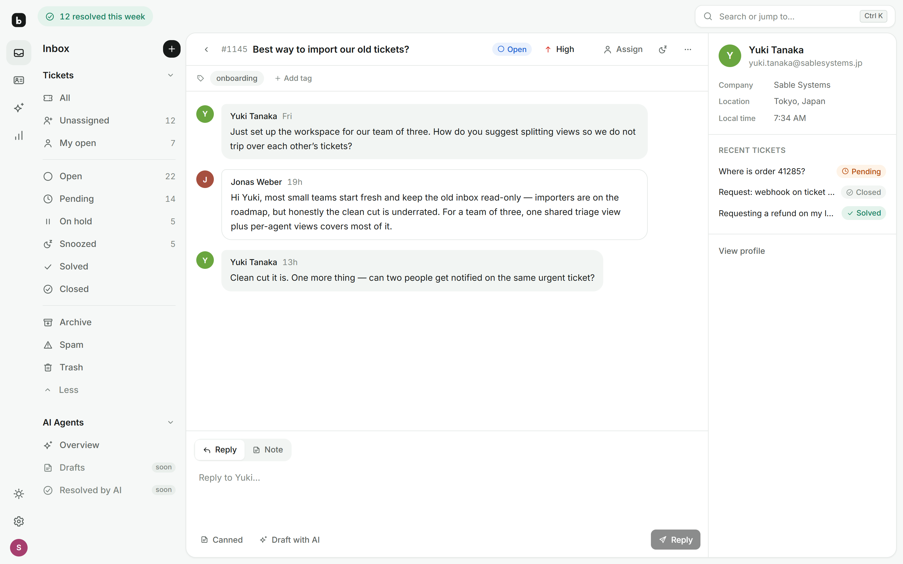 | 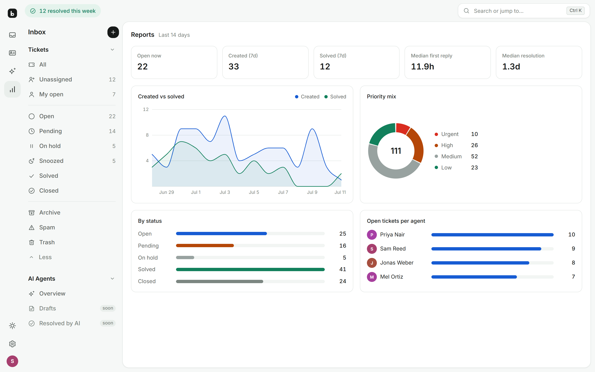 |

Revenue pipeline — deals logged from conversations, rolled up per account:

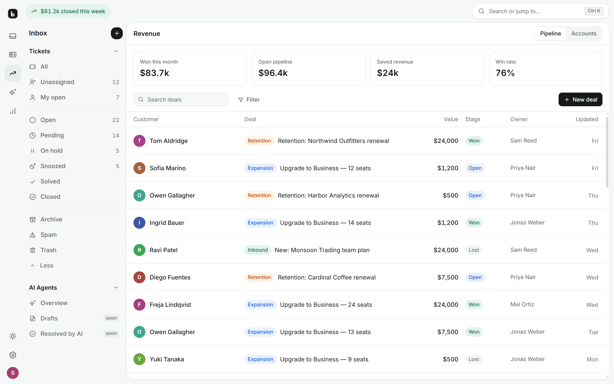

Knowledge base — a categorized help center with a reader and editor:

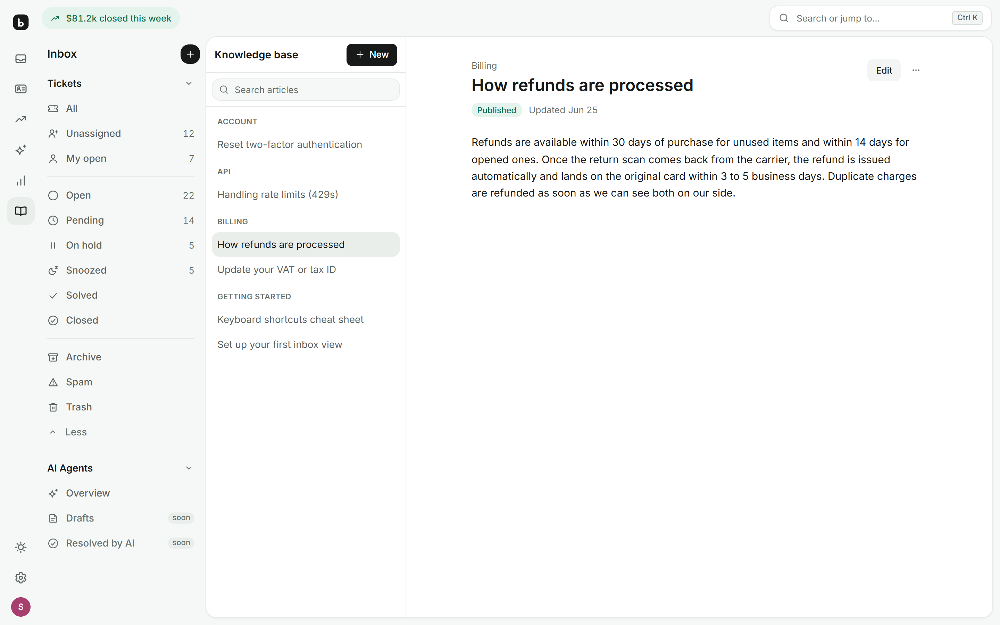

| AI agents — autonomous triage, drafting & auto-resolve | Channels — a multi-source inbox |
| --- | --- |
| 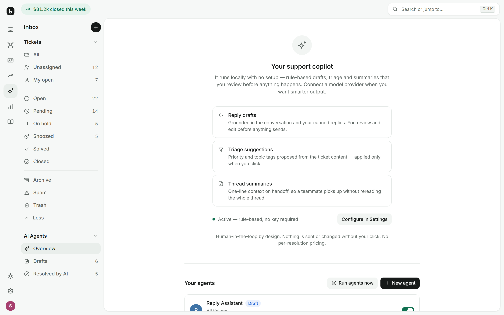 | 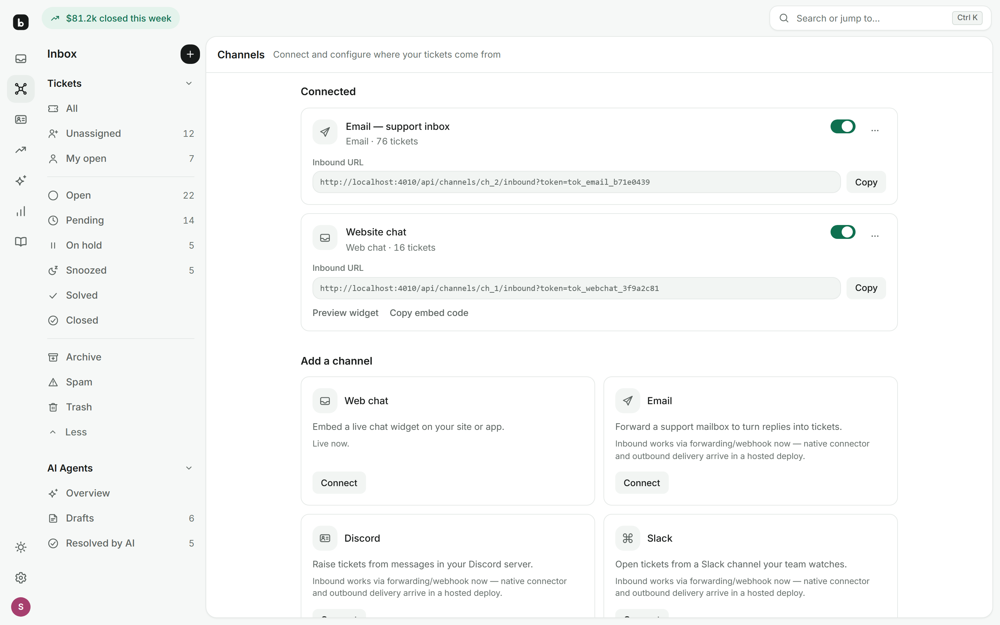 |

Team — invite teammates with roles and shareable links:

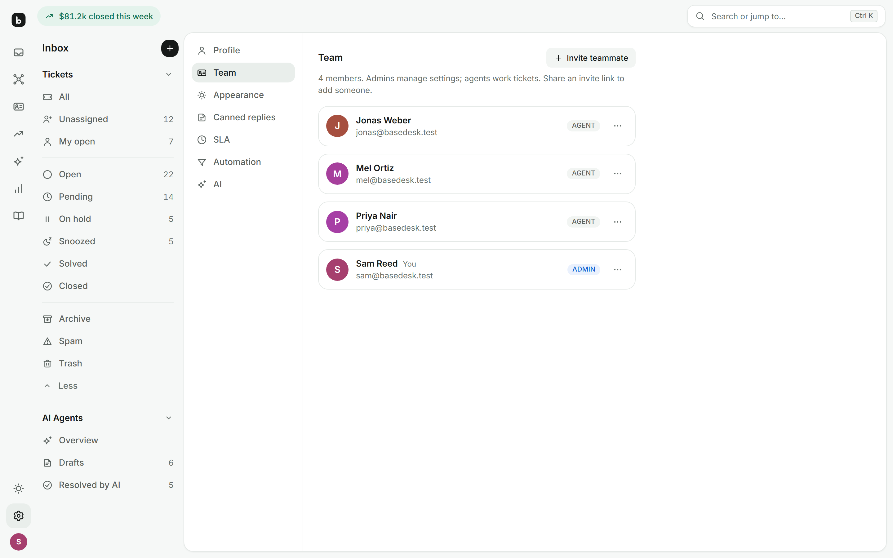

Connect a model — pick a provider and model from a catalog with per-1M pricing and reasoning info, or type any custom id:

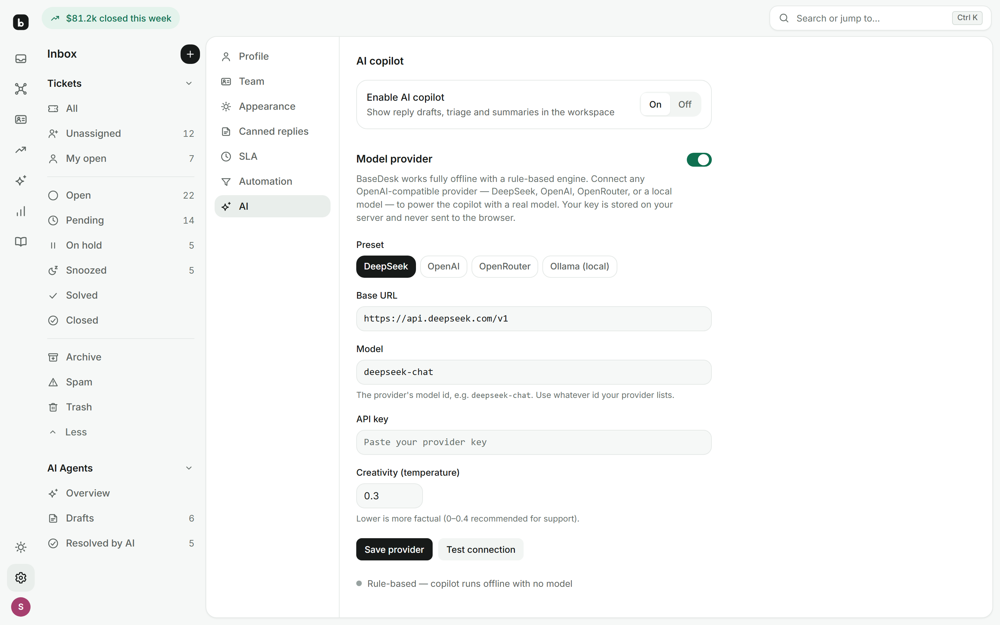

Every AI action shows its token count and estimated cost:

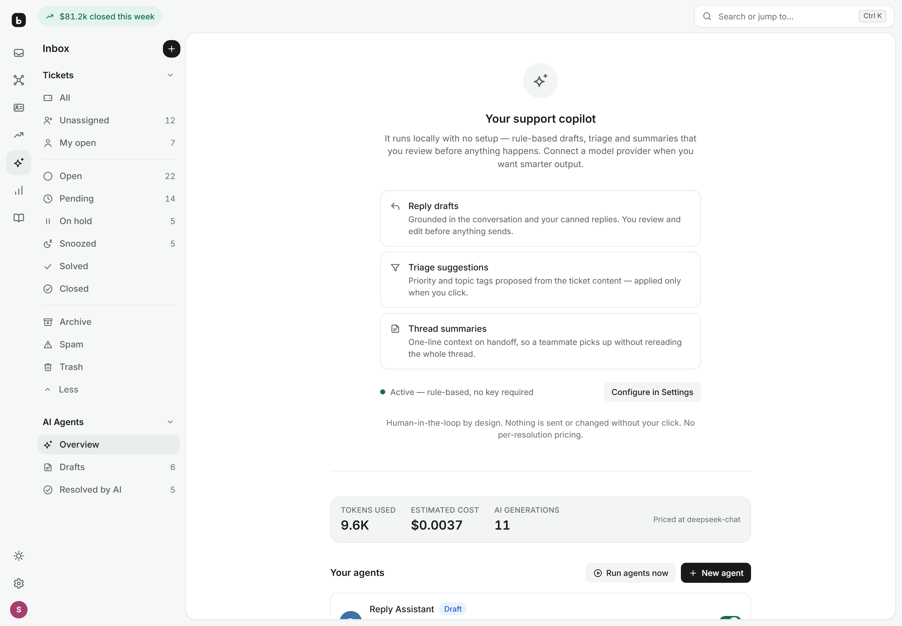

Customer portal — end-users sign in to track and reply to their own tickets:

| Sign in | My tickets | A conversation |
| --- | --- | --- |
| 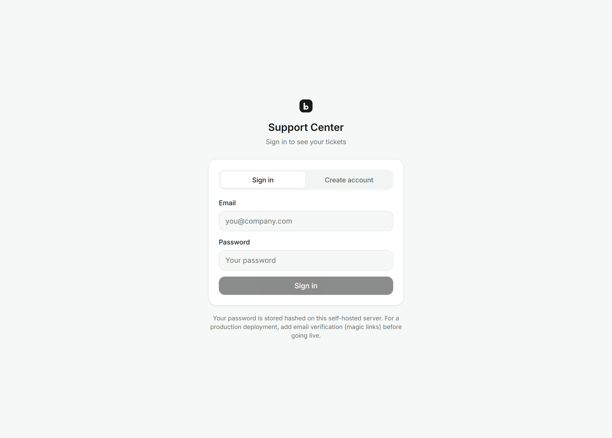 | 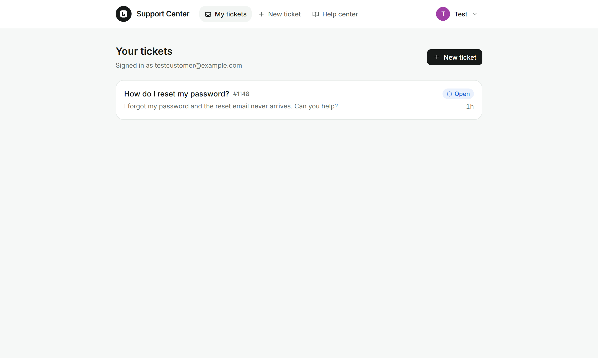 | 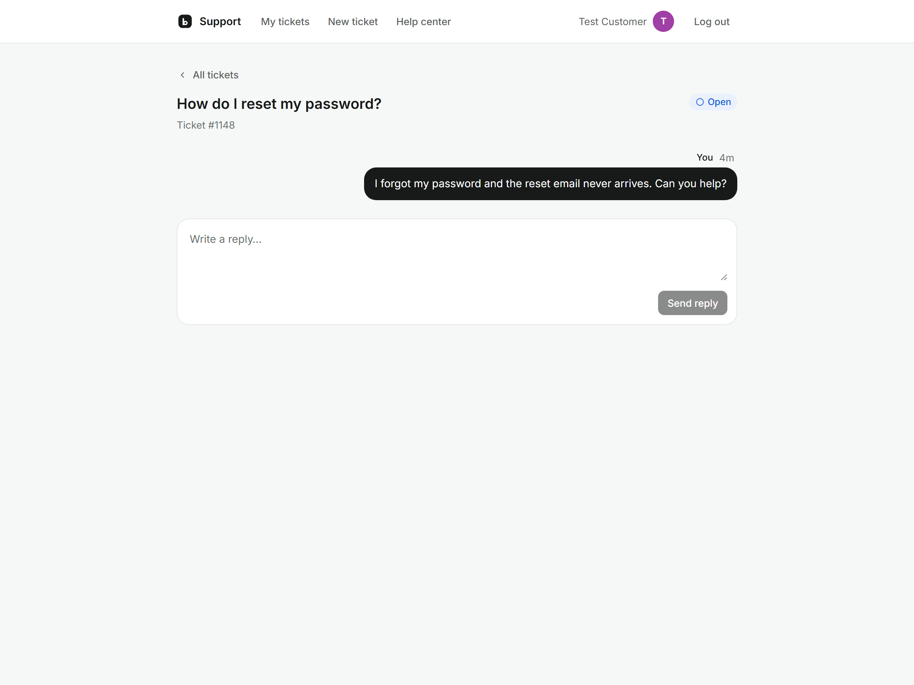 |

<details>
<summary>Dark theme</summary>


</details>

## Quickstart

### Docker (recommended)

```bash
git clone https://github.com/fizzexual/BaseDesk.git
cd BaseDesk
docker compose up -d
# → http://localhost:4010  agent dashboard   (seeded with demo data on first boot)
# → http://localhost:4011  customer portal
```

### From source

Requires Node ≥ 23.4 (built-in SQLite).

```bash
npm install
npm run build
npm start
# → http://localhost:4010  agent dashboard
# → http://localhost:4011  customer portal
```

The same server serves both ports. Data lives in `./data/basedesk.db` (override
with `DATA_DIR`); ports via `ADMIN_PORT` (default 4010) and `PORTAL_PORT` (4011).

## Development

```bash
npm install
npm run dev        # admin :4010 · portal :4011 · API :4012 (Vite proxies to it)
npm test           # server API tests + web store tests
npm run typecheck  # strict TS, both workspaces
```

- `web/` — Vite + React 19 + TypeScript strict + Tailwind v4. Custom design-token system, hand-drawn icon set, in-house SVG charts. One font (Inter Variable). No UI kit.
- `server/` — Hono + `node:sqlite`. REST API, seeds itself with realistic demo data on first boot.
- `shared/` — deterministic seed generator (`npm run seed`).

## The agent workspace

- **Inbox views**: All / Unassigned / My open / Snoozed / per-status / Archive / Spam / Trash, with live counts — switchable between a compact **list** and a **card** layout, **right-click any ticket** for quick actions (assign to me, solve/reopen, snooze, archive, trash), and **multi-select** rows (or select-all) for **bulk actions** — assign, set priority, solve, tag, archive, trash in one go
- **Ticket workspace**: threaded conversation with **file attachments** (attach a screenshot or file to a reply — images preview inline, everything else downloads; 10 MB cap), internal notes with **@mentions that notify the tagged teammate** (a header bell shows the unread count; click through to the ticket), canned replies and **macros** (a canned reply that also sets status/priority/tags or assigns the ticket to you in one click), tags, snooze presets, customer-360 side panel, and **admin-defined custom fields** (text, long text, number, dropdown, checkbox, date) edited right on the ticket
- **Revenue**: log expansion/retention/inbound deals from a conversation; pipeline, account-health rollup, revenue reporting, and a live "closed this week" figure
- **AI copilot** (human-in-the-loop): reply drafts answered **strictly from your knowledge base** by default (the model is given only the relevant articles and told not to invent anything — if the KB doesn't cover it, it says so instead of guessing; a settings toggle relaxes this to general knowledge), priority/tag triage suggestions, and one-line thread summaries. Connects to any OpenAI-compatible model (DeepSeek, OpenAI, OpenRouter, local Ollama), with **per-generation token counts and dollar cost** shown to admins, and always falls back to the rule-based engine. Your API key stays on your server, never in the browser
- **AI agents** (autonomous, human-in-the-loop): configurable agents that triage, draft, or auto-resolve new tickets within a scope you set (tags/priorities), with a suggest → draft → resolve autonomy dial; a pending draft surfaces **right inside the ticket** — approve, edit-into-the-composer, or dismiss without a trip to the queue — and KB-grounded deflections send automatically
- **Channels**: a multi-source inbox — a polished **web-chat launcher** (a floating bottom-right bubble that opens a chat panel; embed it on any site with one `<script>` tag) and a generic inbound webhook work out of the box, and **agent replies deliver back out to the channel they came from**: Discord and Slack via a channel webhook URL, and Telegram/Messenger/WhatsApp/SMS via a generic JSON relay envelope (with an optional Bearer token). Every reply path — a manual reply, an AI-approved draft, an AI auto-resolve — fans out to the channel and to email; each connector has a **Send test** button. **Inbound** messages thread into one ongoing ticket per sender (matched by email or external id — a conversation is one ticket, not one per message), and a token- + HMAC-signed **command** endpoint lets a bot manage a ticket straight from the channel (reply / solve / reopen), so you can run a whole Discord conversation from Discord. All channel secrets stay server-side (masked, in the git-ignored DB). Each ticket shows its source — see [docs/channels.md](docs/channels.md)
- **SLA + automation**: response/resolution targets per priority with live breach indicators and attainment reporting; **business-hours-aware clocks** that pause outside working hours; **multi-condition automation** (All/Any) that sets priority, status, tags, or assignee on create or update
- **Team**: invite teammates with shareable links, admin/agent roles, and per-agent reply signatures (the last active admin is protected)
- **Customer portal** (`/portal`, served on its own port): a separate customer-facing app where end-users sign in (email + password, scrypt-hashed) to see only their own tickets (filter + search), reply, open new tickets, edit their profile, and browse the help center — replies reopen solved tickets, internal notes stay hidden, the ticket view **updates live with a notification chime** when support replies, and it has its own light/dark theme toggle
- **Email notifications**: connect an SMTP server (a small built-in client — no nodemailer) to **email customers when an agent or AI replies**, with a link back to the portal; the password stays on your server. A test-send button verifies your setup
- **Knowledge base**: a categorized help center with a reader and editor, draft/published articles, and search
- **Command palette** (`Ctrl/⌘ K`): jump to any ticket, view, contact, or action
- **Keyboard-first**: `j/k` navigate · `e` solve · `u` assign to me · `1–4` priority · `s` snooze · `r` reply · `n` note · `?` all shortcuts
- **Reports**: created vs solved, priority mix, status distribution, per-agent load, first-reply/resolution medians, and **customer satisfaction** (average score, positive %, ratings received)
- **Light & dark themes**, WCAG-AA contrast

## API

The web app talks to a plain REST API you can use directly — see the route tables in [`docs/superpowers/plans/`](docs/superpowers/plans/). Highlights: `GET /api/bootstrap`, `GET /api/tickets?view=…`, `POST /api/tickets/:id/messages`, `GET /api/deals`, `POST /api/deals`, `GET /api/stats`, `GET /api/search?q=…`.

## Roadmap

- [x] **Support → Revenue** — deals, pipeline, account health, revenue reporting *(v0.2)*
- [x] **AI copilot** — drafts, triage, summaries; rule-based and offline today, model-provider hook for later *(v0.2)*
- [x] **SLA + automation** — targets, breach indicators, attainment; create-time automation rules *(v0.3)*
- [x] **Knowledge base** — categorized articles, reader/editor, draft/published, search *(v0.3)*
- [x] **AI agents** — autonomous triage/draft/auto-resolve with scoped autonomy and approval queues *(v0.4)*
- [x] **Channels** — web-chat widget + inbound webhook live; email/Discord/Slack/WhatsApp via forwarding *(v0.4)*
- [x] **Business-hours-aware SLA clocks** — pause outside working hours *(v0.4)*
- [x] **Multi-condition automation** — All/Any matching, set status/priority/tag/assignee, on create or update *(v0.4)*
- [x] **Team management** — invites, roles, signatures *(v0.4)*; auth/SSO next
- [x] **Customer portal** — end-user sign-in (scrypt-hashed passwords), scoped tickets, replies, new tickets, profile, help center *(v0.5)*; magic-link email verification next
- [x] **Model provider** — connect DeepSeek / any OpenAI-compatible model to power the copilot and agents; a model catalog (8 providers) with per-1M pricing, context, and reasoning info; key kept server-side; rule-based fallback *(v0.5)*
- [ ] Holiday calendars for SLA clocks
- [x] **Outbound email** — SMTP notifications to customers on reply (zero-dep client) *(v0.5)*
- [ ] Inbound email ingestion (IMAP + Gmail/MS365 OAuth) — bulletproof threading or nothing
- [x] **Custom fields** — admin-defined ticket fields (text, long text, number, dropdown, checkbox, date), managed in Settings and edited from the ticket side panel *(v0.6)*
- [x] **Attachments** — upload files on a reply (10 MB cap), stored beside the database and served with `nosniff`/inline-image handling; images preview in-thread *(v0.6)*; portal-side upload next
- [x] **Ticket workspace polish** — approve/edit/dismiss AI drafts inline, closed tickets are read-only (reopen to write), and right-click any message to soft-delete it, leaving an audit tombstone *(v0.6)*
- [x] **CSAT** — customers rate a solved ticket (1–5 ★ + optional comment) from the portal; the score shows on the ticket side panel and rolls up into reports (average, positive %, count) *(v0.6)*
- [x] **Right-click quick actions** — a reusable context menu on inbox rows (assign, solve/reopen, snooze, archive, trash), reusing the same menu primitive as message delete *(v0.6)*
- [x] **Bulk actions** — multi-select inbox rows (+ select-all) and a bulk bar to assign, set priority, solve, tag, archive, or trash many tickets at once, via a `PATCH /api/tickets` bulk endpoint (uniform patch + per-ticket tag union) *(v0.6)*
- [x] **Saved views** — pin a named filter (base view + priority + assignee + tag) to the sidebar; filters are shareable via the URL *(v0.6)*
- [x] **Macros** — extend a canned reply with actions (set status/priority, add tags, assign to me) that fire when you insert it from the composer *(v0.6)*
- [x] **@mention notifications** — @mention a teammate in an internal note and they get a notification (header bell + unread badge, click through to the ticket) *(v0.6)*
- [x] **Outbound channel delivery** — agent/AI replies posted to Discord & Slack channel webhooks, plus a generic JSON relay envelope (optional Bearer token) for Telegram/Messenger/WhatsApp/SMS, with a per-channel test send *(v0.6)*
- [x] **Two-way channels** — inbound threads into one ticket per sender, an HMAC-signed **command** endpoint manages tickets from a bot (reply/solve/reopen), all secrets server-side; connect a provider via a small relay ([docs/channels.md](docs/channels.md)) *(v0.6)*
- [x] **Discord ticket bot** — a turnkey [`bot/`](bot/) (discord.js): drop in a token + app id, invite it, and `/ticket` opens a private thread that *is* a BaseDesk ticket — customer messages sync in, dashboard replies post back, and `/reply` `/solve` `/close` `/reopen` manage it from Discord. Auto-provisions its own channel; token stays in a git-ignored `.env` *(v0.6)*
- [ ] Transparency portal — status page + roadmap/feedback voting (the customer portal itself shipped in v0.5)
- [ ] Migration importers (osTicket, FreeScout, Zendesk CSV)
- [ ] Single-binary packaging

## Philosophy

- Every feature in the open-source core. Forever.
- No telemetry. Your data is a file you own.
- The fastest helpdesk UI in the room, or we're not done.
- AI that makes agents faster, never a wall that keeps customers out.

## License

[MIT](LICENSE)
